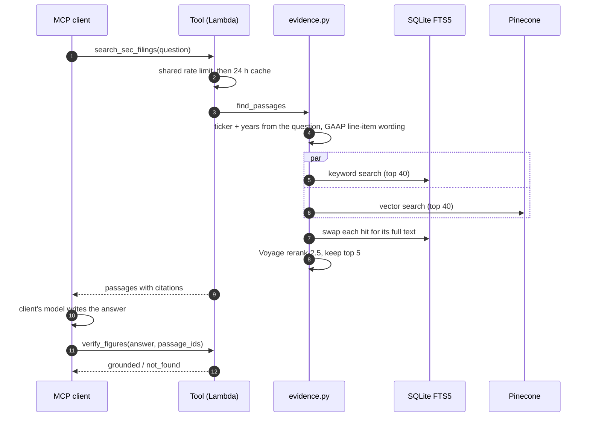

# FinRAG MCP

A public MCP server that gives Claude, Cursor or any MCP client cited passages from real SEC filings, plus a tool that checks every figure in the answer against those passages.

Ask a chatbot for a company's revenue and it may give you stale data or a number it made up. FinRAG searches 10-K, 10-Q and 8-K filings from SEC EDGAR and returns the five best passages, each with a citation. Your own model writes the answer from them, then calls `verify_figures`, which lists every dollar amount, percentage and comma-grouped number it can't find in the cited passages. If nothing matches, the tools say so instead of guessing.

**Live site:** [dashboard-weld-nine-28.vercel.app](https://dashboard-weld-nine-28.vercel.app)

## Connect (no sign-in)

Server URL:

```
https://ecvsxkeqdpyj5hkal7wplm2b4q0gacfh.lambda-url.us-east-1.on.aws/mcp
```

- **Claude (web or desktop):** Customize > Connectors > + Add > Add custom connector. Paste the URL and choose No sign in if asked. On Team and Enterprise plans an Owner adds it first under Organization settings > Connectors. Free plans allow one custom connector.
- **Claude Code:** `claude mcp add --transport http finrag https://ecvsxkeqdpyj5hkal7wplm2b4q0gacfh.lambda-url.us-east-1.on.aws/mcp`
- **Cursor:** add this to `.cursor/mcp.json` in your project or `~/.cursor/mcp.json`. Other clients that speak streamable HTTP take the same URL, though their config keys may differ.

```json
{
  "mcpServers": {
    "finrag": { "url": "https://ecvsxkeqdpyj5hkal7wplm2b4q0gacfh.lambda-url.us-east-1.on.aws/mcp" }
  }
}
```

**Limits:**
- Everyone shares 30 tool calls a minute and 1,000 a day.
- It covers 71 companies. `list_covered_companies` shows the exact forms and years.
- It returns evidence only. Your client's model writes the answer.

[WALKTHROUGH.md](WALKTHROUGH.md) has a step-by-step test of every tool.

## Tools

| Tool | What it returns |
|---|---|
| `search_sec_filings(question, ticker?, fiscal_year?)` | The 5 best passages for a free-text question, with citations |
| `get_company_financials(ticker, metric, period)` | Passages for one company, one metric, one period |
| `compare_companies(tickers, metric, period)` | Passages per company, 2 to 5 tickers, searched in parallel |
| `get_latest_filing(ticker, filing_type?)` | The newest filing of a form (default 10-K) straight from EDGAR, for any company SEC lists, with a link and whether it's in the corpus |
| `list_covered_companies()` | Every company, form and date range that can be searched |
| `verify_figures(answer, passage_ids)` | Each dollar amount, percentage and comma-grouped number in the answer, sorted into `grounded` or `not_found`, plus any `unknown_ids` |

## How it works



- **Corpus:** 1,082 filings (519 10-Q, 299 10-K, 264 8-K), 171,790 chunks, 71 companies. Tables are kept as tables. A weekly job pulls new filings from EDGAR.
- **No chat model on the server.** Query embeddings use OpenAI `text-embedding-3-small`. If the embedding call fails, search falls back to keyword-only and the result says so.
- **Full text before ranking.** Pinecone metadata holds only the first 1,000 characters of a chunk. 75% of chunks are longer than that (the average chunk is 3,728 characters), so every hit is swapped for its full text from the keyword index before reranking. Passages sent to the client are capped at 8,000 characters and marked `[... truncated]` past that.
- **Reranker:** Voyage `rerank-2.5`, a hosted cross-encoder, scores all candidates (up to 40 per search source) against the question and keeps 5. A question that names a fiscal year but no quarter prefers the 10-K over 10-Qs. If Voyage is unreachable, a word-overlap scorer takes over and the search still returns passages. Until 2026-10-30 that word-overlap scorer was all production ever ran: the Lambda never installed the local cross-encoder the code was written for.
- **Verifier:** compares parsed magnitudes, not raw text. A plain substring test would treat a made-up "$1,234" as grounded whenever the source contains "$1,234.56". It does not convert units, so "$1.58 billion" is not grounded by "1,577" (millions), and plain digits like "1577" are not checked.

The full sequence, with every component, is in [diagrams/query-sequence.mmd](diagrams/query-sequence.mmd).

## Results

### Live server (2026-10-30)

Measured against the deployed URL by [scripts/live_check.py](scripts/live_check.py). The raw output is in [dashboard/data/live/live-check.json](dashboard/data/live/live-check.json).

| | |
|---|---|
| Search, warm, cache miss | 1.08 s median, 1.25 s max (10 questions, Voyage reranker) |
| Search, cache hit | 0.37 s median |
| First call after a deploy (cold) | 14.9 s, mostly loading the 964 MB index |
| `initialize` / `tools/list` | 0.30 s / 0.24 s (neither loads the index) |
| Cost per search (estimate) | about $0.0017: about 32,600 Voyage rerank tokens ($0 within the first 200M free), plus 2 GB Lambda for about 1 s and one embedding |

The old pipeline averaged 24.1 s per question, because it spent most of that time waiting on throttled model calls.

### Retrieval gate

Same index, same day, top 5 after reranking:

| Pipeline | Number in top 5 | MRR | Evidence in top 5 |
|---|---|---|---|
| Old (LLM query rewrite) | 51.1% | 0.445 | 10.2% |
| New, without full text | 47.8% | 0.431 | 10.2% |
| New | 52.2% | 0.455 | 13.4% |

The new path drops the LLM rewrite and retrieves about as well: the number lands in the top 5 for one more of 92 questions, and the evidence for four more of 127. Swapping in full text is what makes the difference.

### Neural reranker (2026-10-30)

Same index, same day, top 5. "Lexical" is the word-overlap scorer; every row includes the 10-K preference for fiscal-year questions. 0 Voyage fallbacks in every run. Results: `evals/results/retrieval_*_m3_*.json`.

| Reranker, candidates per source | Evidence in top 5 (127) | Evidence ranked first | Number in top 5 (92) | MRR |
|---|---|---|---|---|
| Before (lexical, 10, no 10-K preference) | 13.4% | 3.1% | 52.2% | 0.455 |
| Lexical, 10 | 22.0% | 8.7% | 53.3% | 0.478 |
| Lexical, 40 | 23.6% | 10.2% | 51.1% | 0.451 |
| Voyage, 10 | 28.3% | 23.6% | 62.0% | 0.555 |
| **Voyage, 40 (live)** | **45.7%** | **36.2%** | **63.0%** | **0.580** |

The 10-K preference alone moved evidence from 13.4% to 22.0%. More candidates only pay off with a neural reranker: the word-overlap scorer got slightly worse with 40.

### Answer quality on the new server (2026-10-30)

Same 150 FinanceBench questions, same retrieval code and index as the live server. gpt-4o-mini plays the client and writes the answers (temperature 0, recorded on every row). The September answers were re-scored with the same code. Script: `evals/run_remeasure.py --tag m3`. Results: `evals/results/remeasure_2026-10-30.json` (word-overlap) and `evals/results/remeasure_m3.json` (Voyage).

| FinanceBench (150) | September | Word-overlap rerank | Voyage rerank (live) |
|---|---|---|---|
| Refused to answer | 121 | 99 | 55 |
| Stated the right number, among answered questions (of 110 with a numeric answer) | 15 | 25 | 49 |
| Answers whose every figure is in the retrieved passages | not measured | 145 (96.7%) | 126 (84%) |

How to read these:

- **Better ranking roughly halved refusals and doubled correct answers.** It still refuses 55 of 150. Most remaining refusals are ratio questions (working capital, days payable) that need several statement lines in the same 5 passages.
- **The figure check fell because more answers compute something.** 23 of the 95 answers contain a figure not found verbatim: mostly ratios the model calculated ("2.1%") or unit conversions ("$8.738 billion" for 8,738 million). `verify_figures` does not convert units or check arithmetic, by design, so it flags these for the client to show.
- **"Stated the right number" is an automated check** (within 2% of the ground truth) and is not hand-graded. An earlier version counted stray numbers inside refusals as hits; that inflated the September figure to 52, which is why I now count answered questions only.
- **The 48 hand-verified custom questions:** refusals fell from 42 to 18 with the Voyage reranker. The automated number check matches only 1 of the 48, so whether those answers are right needs hand grading.
- **ragas was not re-run.** Its September scores are below.

### Answer quality (September 2026, before this server)

Tested on [FinanceBench](https://huggingface.co/datasets/PatronusAI/financebench) (150 public questions) plus 48 questions I verified by hand against the filings (`evals/eval_data/custom_150.json`).

**Which model wrote these answers:** mostly gpt-4o-mini, not Claude Sonnet as I first reported. This account's Bedrock quota was 0, so generation silently fell back to OpenAI. CloudWatch shows 241 successful Bedrock calls against about 20,000 throttles over 100 days, and the answer files never recorded the model. Eval answers now come from one named model (`FINRAG_EVAL_MODEL`, default gpt-4o-mini), which is recorded on every row. The re-measure above replaces them as the current numbers.

| Metric | FinanceBench (150) | Custom (48) | Combined (198) |
|---|---|---|---|
| Numerical accuracy | 91.0% | 86.2% | 89.9% |
| Faithfulness | 79.4% | 85.4% | 80.2% |
| Answer relevancy | 15.6% | 16.3% | 16.2% |
| Context precision | 20.3% | 3.1% | 15.3% |
| Context recall | 9.5% | 2.1% | 8.9% |

How to read these:

- **Numerical accuracy** is the share of numbers in an answer that appear in the retrieved text. It checks that the system doesn't invent numbers, not that it answers. An answer with no numbers scores 1.0, so refusing inflates it.
- **The system refused a lot.** About four in five FinanceBench answers were refusals. Some questions need years or documents that aren't in the corpus, and in a rough check the right chunk was in the top five only about half the time.
- **The ragas metrics are low** partly because of the refusals (ragas scores a refusal as 0 relevancy) and partly because of missing data. Whether they also fit this task badly (short numeric answers judged against long table chunks) is untested.

### Keyword vs hybrid search

I compared three setups on the same 150 questions:

| Setup | Numerical accuracy | Refused (of 150) | States the true number (of 110) |
|---|---|---|---|
| Vector only | 86.5% | 121 | 52 |
| Keyword only | 94.4% | 133 | 48 |
| Full pipeline | 91.0% | 121 | 52 |

Keyword-only scored highest, and I first published that as "keyword search beats the pipeline". That was a mistake in how I read the metric: it refused the most, and refusing raises the score. Refusals explain only part of its lead, though. On a rough check of whether the answer states the correct number, the three setups are within noise (52, 48, 52), so this benchmark can't rank them either way. Reproduce with `PYTHONPATH=. python3 evals/analyze_baseline_gap.py`.

### Corpus gaps

- Spotify files a 20-F, not 10-K/10-Q, so it's out of scope.
- 14 FinanceBench questions ask about earnings call transcripts, which aren't ingested on purpose.
- Only 19 of 71 companies have 8 or more 10-Ks. Most filings are from 2022 on.

## Deployment

AWS Lambda behind a Function URL, with no API Gateway. A cold start downloads the 964 MB index (14.9 s when measured), close enough to API Gateway's 29 second cap that a slow download would cross it. The Function URL allows the Lambda's full 2 minutes.

- Python 3.13, arm64, 2 GB memory, 2 GB ephemeral storage. Async retries are off.
- No sign-in. A shared DynamoDB rate limit (30 a minute, 1,000 a day) protects the account. It fails open if DynamoDB is down.
- A 24 h DynamoDB cache for identical tool calls. Degraded results, like keyword-only searches, are never cached.
- Every tool call is logged as a `finrag_call` line in CloudWatch (kept 30 days) and as a DynamoDB item that expires after 90 days.
- An EventBridge health check runs a real search every 5 minutes, which also keeps one instance warm. Alarms on server errors and refresh failures publish to an SNS topic, which emails you only if you deploy with `-c alert_email`.
- A weekly EventBridge job refreshes the corpus from EDGAR.
- Secrets are in SSM Parameter Store. IAM is scoped to the specific resources used.

### Deploy your own

You need an AWS account with the CLI configured, Node 20 or newer, Python 3.12 or newer, an OpenAI API key and a Pinecone account. Everything deploys to us-east-1.

1. In Pinecone, create a serverless index named `finrag-filings` with 1536 dimensions and the cosine metric (it must match OpenAI `text-embedding-3-small`).
2. Clone and install:

   ```bash
   git clone https://github.com/karthikreddyyalala/FinRAG.git && cd FinRAG
   python3 -m venv .venv && source .venv/bin/activate
   pip install -r requirements.txt
   ```
3. S3 bucket names are global, so rename the two buckets to your own (replace `yourname`):

   ```bash
   perl -pi -e 's/finrag-(raw|processed)-filings/yourname-$1-filings/g' $(git grep -lE 'finrag-(raw|processed)-filings' -- '*.py')
   ```
   Also set `SEC_USER_AGENT` in `pipeline/edgar_client.py` to your own name and email. SEC asks every client to identify itself.
4. Store your keys where the Lambdas read them:

   ```bash
   aws ssm put-parameter --region us-east-1 --name /finrag/openai-api-key --type SecureString --value <your-openai-key>
   aws ssm put-parameter --region us-east-1 --name /finrag/pinecone-api-key --type SecureString --value <your-pinecone-key>
   aws ssm put-parameter --region us-east-1 --name /finrag/voyage-api-key --type SecureString --value <your-voyage-key>
   ```
   All three are required: a Lambda fails its cold start if one is missing. Voyage needs a payment method on file; without one it allows 10K tokens a minute and a single search uses about 33K. The first 200M tokens are free.
5. Deploy. `cdk.json` already points at the app, and `bootstrap` is needed once per account and region:

   ```bash
   npx aws-cdk bootstrap aws://<account-id>/us-east-1
   npx aws-cdk deploy --all --require-approval never -c alert_email=you@example.com
   ```
   `-c alert_email` is optional. It subscribes that address to the alarms (confirm the email AWS sends) and adds a $10 monthly budget alert. Until step 6 finishes, the 5-minute health check fails and the error alarm fires.
6. Build the corpus. This runs locally, reads the keys from the environment, and takes hours. It pays OpenAI for about 170,000 chunk embeddings (a few dollars) and writes them to Pinecone; the free tier's monthly write limit may not cover all of it, and the script resumes where it stopped.

   ```bash
   export OPENAI_API_KEY=<your-openai-key> PINECONE_API_KEY=<your-pinecone-key>
   PYTHONPATH=. python scripts/bootstrap_corpus.py
   aws s3 sync evals/results/chunk_cache s3://yourname-processed-filings/chunk_cache/
   ```
   The sync gives the weekly refresh its starting point; without it the refresh tries to re-ingest everything. PYPL is skipped because it is listed in `KNOWN_UNAVAILABLE` in `scripts/bootstrap_corpus.py`; remove it there to include it.
7. Connect your client to the `McpEndpoint` stack output (it already ends in `/mcp`), the same way as above.

## Status

Done: ingestion, hybrid retrieval with full-text hydration, neural reranking (Voyage), figure verifier, six evidence tools, public deployment with rate limits, caching, logging, health checks and alarms, weekly refresh, eval harness, public site.

Next: XBRL facts for any public company, multi-line retrieval for ratio questions, hand-graded answers for the custom set.

What changed, what was broken before, and what each change measured: [CHANGELOG.md](CHANGELOG.md).

Other diagrams are in `diagrams/`. `ingestion-sequence.mmd` is current; `week1-sequence.mmd` and `week3-eval-sequence.mmd` show earlier designs, kept as history.
