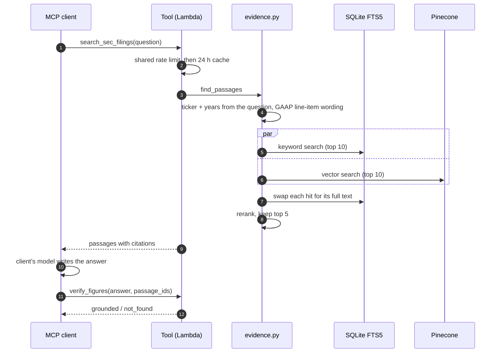

# FinRAG MCP

A public MCP server that gives Claude, Cursor or any MCP client cited passages from real SEC filings, plus a tool that checks every figure in the answer against those passages.

Ask a chatbot for a company's revenue and it may give you stale data or a number it made up. FinRAG searches 10-K, 10-Q and 8-K filings from SEC EDGAR and returns the five best passages, each with a citation. Your own model writes the answer from them, then calls `verify_figures`, which lists every number it can't find in the cited passages. If nothing matches, the tools say so instead of guessing.

**Live site:** [dashboard-weld-nine-28.vercel.app](https://dashboard-weld-nine-28.vercel.app)

## Connect (no sign-in)

Server URL:

```
https://ecvsxkeqdpyj5hkal7wplm2b4q0gacfh.lambda-url.us-east-1.on.aws/mcp
```

- **Claude (web or desktop):** add it as a custom connector and paste the URL.
- **Claude Code:** `claude mcp add --transport http finrag https://ecvsxkeqdpyj5hkal7wplm2b4q0gacfh.lambda-url.us-east-1.on.aws/mcp`
- **Cursor and other clients that speak streamable HTTP:**

```json
{
  "mcpServers": {
    "finrag": { "url": "https://ecvsxkeqdpyj5hkal7wplm2b4q0gacfh.lambda-url.us-east-1.on.aws/mcp" }
  }
}
```

**Limits:**
- Everyone shares 30 tool calls a minute and 1,000 a day.
- It covers 71 companies. `list_covered_companies` shows the exact forms and years.
- It returns evidence only. Your client's model writes the answer.

[WALKTHROUGH.md](WALKTHROUGH.md) has a step-by-step test of every tool.

## Tools

| Tool | What it returns |
|---|---|
| `search_sec_filings(question, ticker?, fiscal_year?)` | The 5 best passages for a free-text question, with citations |
| `get_company_financials(ticker, metric, period)` | Passages for one company, one metric, one period |
| `compare_companies(tickers, metric, period)` | Passages per company, 2 to 5 tickers, searched in parallel |
| `get_latest_filing(ticker, filing_type)` | The newest 10-K, 10-Q or 8-K straight from EDGAR, with a link and whether it's in the corpus |
| `list_covered_companies()` | Every company, form and date range that can be searched |
| `verify_figures(answer, passage_ids)` | Each number in the answer, sorted into `grounded` or `not_found` |

## How it works



- **Corpus:** 1,082 filings (519 10-Q, 299 10-K, 264 8-K), 171,790 chunks, 71 companies. Tables are kept as tables. A weekly job pulls new filings from EDGAR.
- **No chat model on the server.** Query embeddings use OpenAI `text-embedding-3-small`. If the embedding call fails, search falls back to keyword-only and the result says so.
- **Full text before ranking.** Pinecone metadata holds only the first 1,000 characters of a chunk. 75% of chunks are longer (3,728 on average), so every hit is swapped for its full text from the keyword index before reranking.
- **Reranker:** a word-overlap scorer. A neural reranker is next.
- **Verifier:** compares parsed magnitudes, not raw text. A plain substring test would treat a made-up "$1,234" as grounded whenever the source contains "$1,234.56".

The full sequence, with every component, is in [diagrams/query-sequence.mmd](diagrams/query-sequence.mmd).

## Results

### Live server (2026-10-30)

Measured against the deployed URL by [scripts/live_check.py](scripts/live_check.py). The raw output is in [dashboard/data/live/live-check.json](dashboard/data/live/live-check.json).

| | |
|---|---|
| Search, warm, cache miss | 0.92 s median, 1.15 s max (10 questions) |
| Search, cache hit | 0.34 s median |
| First call after a deploy (cold) | 14.9 s, mostly loading the 964 MB index |
| `initialize` / `tools/list` | 0.30 s / 0.24 s (neither loads the index) |
| Cost per search (estimate) | about $0.00003: 2 GB Lambda for about 1 s, plus one embedding |

The old pipeline averaged 24.1 s per question, because it spent most of that time waiting on throttled model calls.

### Retrieval gate

Same index, same day, top 5 after reranking:

| Pipeline | Number in top 5 | MRR | Evidence in top 5 |
|---|---|---|---|
| Old (LLM query rewrite) | 51.1% | 0.445 | 10.2% |
| New, without full text | 47.8% | 0.431 | 10.2% |
| New | 52.2% | 0.455 | 13.4% |

The new path drops the LLM rewrite and still retrieves slightly better. Swapping in full text is what makes the difference.

### Answer quality (September 2026, before this server)

Tested on [FinanceBench](https://huggingface.co/datasets/PatronusAI/financebench) (150 public questions) plus 48 questions I verified by hand against the filings (`evals/eval_data/custom_150.json`).

**Which model wrote these answers:** mostly gpt-4o-mini, not Claude Sonnet as I first reported. This account's Bedrock quota was 0, so generation silently fell back to OpenAI. CloudWatch shows 241 successful Bedrock calls against about 20,000 throttles over 100 days, and the answer files never recorded the model. Eval answers now come from one named model (`FINRAG_EVAL_MODEL`, default gpt-4o-mini), which is recorded on every row. These numbers will be re-measured on the new server.

| Metric | FinanceBench (150) | Custom (48) | Combined (198) |
|---|---|---|---|
| Numerical accuracy | 91.0% | 86.2% | 89.9% |
| Faithfulness | 79.4% | 85.4% | 80.2% |
| Answer relevancy | 15.6% | 16.3% | 16.2% |
| Context precision | 20.3% | 3.1% | 15.3% |
| Context recall | 9.5% | 2.1% | 8.9% |

How to read these:

- **Numerical accuracy** is the share of numbers in an answer that appear in the retrieved text. It checks that the system doesn't invent numbers, not that it answers. An answer with no numbers scores 1.0, so refusing inflates it.
- **The system refused a lot.** About four in five FinanceBench answers were refusals. Some questions need years or documents that aren't in the corpus, and in a rough check the right chunk was in the top five only about half the time.
- **The ragas metrics are low** partly because of the refusals (ragas scores a refusal as 0 relevancy) and partly because of missing data. Whether they also fit this task badly (short numeric answers judged against long table chunks) is untested.

### Keyword vs hybrid search

I compared three setups on the same 150 questions:

| Setup | Numerical accuracy | Refused (of 150) | States the true number (of 110) |
|---|---|---|---|
| Vector only | 86.5% | 121 | 52 |
| Keyword only | 94.4% | 133 | 48 |
| Full pipeline | 91.0% | 121 | 52 |

Keyword-only scored highest, and I first published that as "keyword search beats the pipeline". That was a mistake in how I read the metric: it refused the most, and refusing raises the score. Refusals explain only part of its lead, though. On a rough check of whether the answer states the correct number, the three setups are within noise (52, 48, 52), so this benchmark can't rank them either way. Reproduce with `PYTHONPATH=. python3 evals/analyze_baseline_gap.py`.

### Corpus gaps

- Spotify files a 20-F, not 10-K/10-Q, so it's out of scope.
- 14 FinanceBench questions ask about earnings call transcripts, which aren't ingested on purpose.
- Only 19 of 71 companies have 8 or more 10-Ks. Most filings are from 2022 on.

## Deployment

AWS Lambda behind a Function URL. There's no API Gateway, because a cold start that downloads the index takes longer than API Gateway's 29 second limit.

- Python 3.13, arm64, 2 GB memory, 2 GB ephemeral storage. Async retries are off.
- No sign-in. A shared DynamoDB rate limit (30 a minute, 1,000 a day) protects the account. It fails open if DynamoDB is down.
- A 24 h DynamoDB cache for identical tool calls. Degraded results, like keyword-only searches, are never cached.
- Every call is logged as a `finrag_call` line in CloudWatch and as a DynamoDB item that expires after 90 days.
- An EventBridge health check runs a real search every 5 minutes. Alarms on server errors and refresh failures publish to an SNS topic.
- A weekly EventBridge job refreshes the corpus from EDGAR.
- Secrets are in SSM Parameter Store. IAM is scoped to the specific resources used.

### Deploy your own

```bash
git clone https://github.com/karthikreddyyalala/FinRAG.git && cd FinRAG
aws ssm put-parameter --name /finrag/openai-api-key --type SecureString --value <your-key>
aws ssm put-parameter --name /finrag/pinecone-api-key --type SecureString --value <your-key>
PYTHONPATH=. npx aws-cdk deploy --all --app "python3 infra/app.py" --require-approval never
python3 scripts/bootstrap_corpus.py
```

Then connect your client to the `McpEndpoint` output, the same way as above. Add `-c alert_email=you@example.com` to the deploy to get alarm emails and a $10 monthly budget alert.

## Status

Done: ingestion, hybrid retrieval with full-text hydration, figure verifier, six evidence tools, public deployment with rate limits, caching, logging, health checks and alarms, weekly refresh, eval harness, public site.

Next: XBRL facts for any public company, a neural reranker, re-measuring answer quality on the new server, an eval that penalizes refusals.

Other diagrams are in `diagrams/`.
