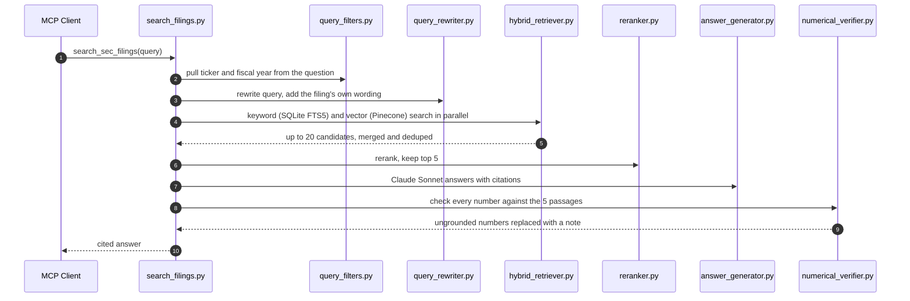

# FinRAG MCP

An MCP server that answers financial questions from real SEC filings, with citations, and checks every number in the answer against the source before returning it.

Ask a chatbot for a company's revenue and it may give you stale data or a number it made up. FinRAG searches 10-K, 10-Q and 8-K filings from SEC EDGAR, answers from the best five passages, and removes any figure it can't find in them. If it can't find the answer, it says so.

**Live site:** [dashboard-weld-nine-28.vercel.app](https://dashboard-weld-nine-28.vercel.app) (a recorded query, the number verifier running in your browser, and the eval results).

## How it works



- **Corpus:** 1,030 filings (506 10-Q, 284 10-K, 240 8-K), 164,092 chunks, 70 companies. Tables are kept as tables. A weekly job pulls new filings from EDGAR.
- **Tools:** `search_sec_filings`, `get_company_financials`, `compare_companies`, `get_latest_filing`.
- **Models:** Claude Haiku rewrites queries and answers single lookups, Sonnet writes full answers. OpenAI embeddings. OpenAI gpt-4o-mini is the fallback if Bedrock is throttled.
- **Reranker:** a word-overlap scorer. A CrossEncoder would be better but needs a container Lambda, so it isn't deployed.

## Results

Tested on [FinanceBench](https://huggingface.co/datasets/PatronusAI/financebench) (150 public questions) plus 48 questions I verified by hand against the filings (`evals/eval_data/custom_150.json`).

| Metric | FinanceBench (150) | Custom (48) | Combined (198) |
|---|---|---|---|
| Numerical accuracy | 91.0% | 86.2% | 89.9% |
| Faithfulness | 79.4% | 85.4% | 80.2% |
| Answer relevancy | 15.6% | 16.3% | 16.2% |
| Context precision | 20.3% | 3.1% | 15.3% |
| Context recall | 9.5% | 2.1% | 8.9% |

How to read these:

- **Numerical accuracy** is the share of numbers in an answer that appear in the retrieved text. It checks that the system doesn't invent numbers, not that it answers. An answer with no numbers scores 1.0, so refusing inflates it.
- **The system refuses a lot.** About four in five FinanceBench answers were refusals. Some questions need years or documents that aren't in the corpus, and in a rough check the right chunk was in the top five only about half the time.
- **The ragas metrics are low** partly because of the refusals (ragas scores a refusal as 0 relevancy) and partly because of missing data. Whether they also fit this task badly (short numeric answers judged against long table chunks) is untested.

### Keyword vs hybrid search

I compared three setups on the same 150 questions:

| Setup | Numerical accuracy | Refused (of 150) | States the true number (of 110) |
|---|---|---|---|
| Vector only | 86.5% | 121 | 52 |
| Keyword only | 94.4% | 133 | 48 |
| Full pipeline | 91.0% | 121 | 52 |

Keyword-only scored highest, and I first published that as "keyword search beats the pipeline". That was a mistake in how I read the metric: it refused the most, and refusing raises the score. But refusals explain only part of its lead, and on a rough check of whether the answer states the correct number the three setups are within noise (52, 48, 52). So this benchmark can't rank them either way. Reproduce with `PYTHONPATH=. python3 evals/analyze_baseline_gap.py`.

### Cost and latency

Fixed set of 15 FinanceBench questions against the real services. Cost is an estimate from text length, not the AWS bill.

| | Before caching and routing | After |
|---|---|---|
| Avg cost per query | $0.0137 | $0.0126 |
| Avg latency | 24.1 s | 24.1 s |

It barely moved because this set only uses `search_sec_filings`. A repeated question hits a 24-hour cache in about 67 ms for $0. Haiku was about 3x cheaper than Sonnet on one single-metric spot-check.

### Corpus gaps

- Spotify files a 20-F, not 10-K/10-Q, so it's out of scope.
- PayPal is missing because the Pinecone free tier hit its monthly write cap.
- 14 FinanceBench questions ask about earnings call transcripts, which aren't ingested on purpose.
- Only 19 of 70 companies have 8 years of history. Most filings are from 2022 on.

## Deployment

AWS Lambda behind a Function URL (no API Gateway, because a cold start that downloads the ~900 MB keyword index is longer than its 29 second limit).

- Python 3.13, arm64, 2 GB memory, 2 GB ephemeral storage.
- Cognito OAuth 2.1 with PKCE, checked before any other work. This is a single-user deployment with no self-signup, so to try it you need to deploy your own.
- Secrets in SSM Parameter Store. IAM scoped to the specific resources used.
- A CloudWatch dashboard graphs Lambda invocations, errors and latency. Per-query cost and latency are logged to DynamoDB.
- A weekly EventBridge job refreshes the corpus from EDGAR.
- Account concurrency limit is 10, which is fine for a demo.

**Connecting Claude Desktop** needs [`mcp-remote`](https://www.npmjs.com/package/mcp-remote), since it only speaks stdio:

```json
{
  "mcpServers": {
    "finrag": {
      "command": "npx",
      "args": [
        "-y", "mcp-remote",
        "<Function URL>/mcp",
        "--static-oauth-client-info", "{\"client_id\":\"<your app client id>\"}",
        "--static-oauth-client-metadata", "{\"scope\":\"openid finrag/invoke\",\"token_endpoint_auth_method\":\"none\"}"
      ]
    }
  }
}
```

Both flags are needed. Cognito doesn't support dynamic client registration, and its discovery metadata doesn't list custom scopes, so without them login works but every request returns 401. Fully quit Claude Desktop after editing the config; it only reads it at launch.

## Status

Done: ingestion, retrieval, verifier, eval harness, four tools, Lambda deployment, Cognito, weekly refresh, public site.

Next: quarter-aware filters, a real CrossEncoder reranker, an eval that penalizes refusals, the remaining 101 custom questions.

See `claude.md` for the full build history. Diagrams are in `diagrams/`.
